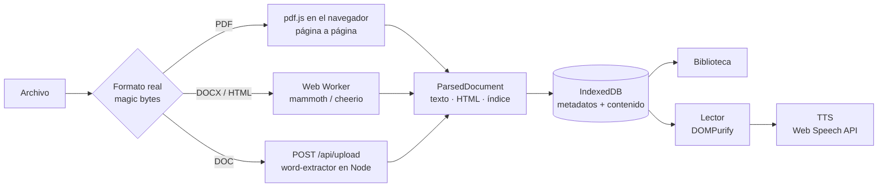

# DocReader Pro

**🌐 Demo en línea: [docreader-pro-alpha.vercel.app](https://docreader-pro-alpha.vercel.app)**

Aplicación web para **leer documentos PDF, Word y HTML en español** sin distracciones: extrae el texto limpio, genera un índice navegable y lo **lee en voz alta** resaltando cada palabra. Todo se guarda en el navegador; los PDF, DOCX y HTML ni siquiera salen de tu equipo.

## Características

- **Formatos:** `.pdf`, `.docx`, `.doc` (Word 97-2003), `.html` y `.htm`. El formato se detecta por el contenido real del archivo (magic bytes), no por la extensión.
- **Sin límite de tamaño práctico** para PDF, DOCX y HTML: se procesan en el navegador (los PDF página a página; DOCX y HTML en un Web Worker para no congelar la interfaz).
- **Índice automático:** títulos de Word (estilos «Título 1/2/3», o párrafos en negrita si no hay estilos), tamaño de letra en PDF y heurísticas en `.doc` («CAPÍTULO I», «1.2 Alcance», «CONCLUSIONES»…).
- **Limpieza de PDF:** quita encabezados y pies repetidos y números de página, une palabras cortadas con guion y párrafos que cruzan de página.
- **Lector limpio:** tipografía cuidada, tamaño de letra, fuente serif/sans, ancho de columna, interlineado y temas claro, oscuro y sepia. Recuerda dónde te quedaste en cada documento.
- **Lectura en voz alta (TTS):** voz en español por defecto, velocidad de 0.5× a 2×, resaltado del párrafo, la frase y la palabra, y pausa automática al saltar de sección.
- **Biblioteca local** en IndexedDB: búsqueda sin tildes, filtros, orden, renombrar y eliminar con «Deshacer».
- **Accesible (WCAG 2.2 AA):** navegación completa por teclado, lectores de pantalla y movimiento reducido. Lighthouse: accesibilidad 100.

## Stack

| Área               | Tecnología                                                           |
| ------------------ | -------------------------------------------------------------------- |
| Framework          | Next.js 15 (App Router) + React 19 + TypeScript                      |
| Estilos y UI       | Tailwind CSS 4, shadcn/ui (Base UI), Framer Motion, lucide-react     |
| Estado             | Zustand · next-themes · Sonner (notificaciones)                      |
| Subida             | react-dropzone                                                       |
| Parsers            | pdfjs-dist, mammoth + JSZip, cheerio, word-extractor (solo servidor) |
| Seguridad del HTML | Lista blanca propia con cheerio + DOMPurify                          |
| Persistencia       | IndexedDB (`idb`) y localStorage                                     |
| Voz                | Web Speech API + CSS Custom Highlight API                            |
| Calidad            | Vitest + Testing Library + axe-core, ESLint, Prettier                |

## Requisitos

- Node.js **20.9 o superior** (probado con Node 26) y npm.
- Un navegador moderno (Chrome, Edge, Safari o Firefox reciente). La voz depende de las voces instaladas en el sistema.

## Instalación y uso

```bash
npm install          # instala dependencias y copia el worker de pdf.js a public/
cp .env.example .env.local   # opcional: ajustar límites del servidor
npm run dev          # http://localhost:3000
```

Producción:

```bash
npm run build
npm start
```

## Scripts

| Script                            | Qué hace                                                   |
| --------------------------------- | ---------------------------------------------------------- |
| `npm run dev`                     | Servidor de desarrollo (Turbopack)                         |
| `npm run build` / `npm start`     | Compilación y servidor de producción                       |
| `npm test`                        | Todos los tests (Vitest)                                   |
| `npm run test:watch`              | Tests en modo vigilancia                                   |
| `npm run test:coverage`           | Tests con cobertura (falla si baja de 80 %; 75 % en ramas) |
| `npm run lint`                    | ESLint                                                     |
| `npm run typecheck`               | Comprobación de tipos de TypeScript                        |
| `npm run format` / `format:check` | Prettier                                                   |
| `npm run fixtures`                | Regenera los documentos de ejemplo de `tests/fixtures`     |

El `.doc` de ejemplo se genera con Microsoft Word: `powershell -ExecutionPolicy Bypass -File scripts/make-doc-fixture.ps1`.

## Variables de entorno

Todas son opcionales (ver [`.env.example`](.env.example)):

| Variable               | Por defecto | Uso                                                                                                                          |
| ---------------------- | ----------- | ---------------------------------------------------------------------------------------------------------------------------- |
| `MAX_UPLOAD_MB`        | `20`        | Tamaño máximo de archivo **subido al servidor** (`/api/upload`). No afecta a PDF/DOCX/HTML, que se procesan en el navegador. |
| `RATE_LIMIT_MAX`       | `20`        | Subidas permitidas por IP en cada ventana.                                                                                   |
| `RATE_LIMIT_WINDOW_MS` | `60000`     | Duración de la ventana del rate limit.                                                                                       |

## Arquitectura

```
app/
  (main)/page.tsx              Biblioteca (subida + lista)
  (main)/reader/[id]/page.tsx  Lector
  api/upload/route.ts          POST: valida y parsea (.doc obligatorio, resto opcional) · GET: límites
  error.tsx · not-found.tsx    Páginas de error en español
components/
  upload/      Dropzone, UploadQueue
  library/     LibraryView, DocumentCard, LibraryToolbar, diálogos
  reader/      DocumentReader, TableOfContents, ReaderSettings, TTSControls
lib/
  parsers/     pdf, docx, doc, html, detección por magic bytes, factory, Web Worker
  db/          IndexedDB (metadatos y contenido en almacenes separados)
  store/       Zustand: biblioteca y cola de subidas
  upload/      decide dónde procesar cada archivo
  reader/      sanitizado con DOMPurify, cálculo de progreso
  tts/         bloques legibles, división en frases, voces, resaltado
  server/      manejador de /api/upload, rate limit, configuración
  utils/       texto, búsqueda, reintentos
hooks/         useDocuments, useReaderSettings, useReadingProgress, useActiveSection, useTTS
types/         ParsedDocument y DocumentMeta
tests/         214 tests + fixtures en español
```

### Flujo de datos



1. **Detección:** `lib/parsers/detect.ts` identifica el formato por su firma (`%PDF-`, ZIP con `word/`, OLE2, marcas HTML).
2. **Procesado:** `lib/upload/process-file.ts` elige dónde parsear. Los `.doc` necesitan Node (`fs`, `stream`), por eso pasan por el servidor; suelen ser archivos pequeños.
3. **Resultado común:** todos los parsers devuelven el mismo `ParsedDocument` (texto plano para voz y búsqueda, HTML limpio para leer e índice `sections`).
4. **Persistencia:** IndexedDB guarda los metadatos aparte del contenido, para que la biblioteca cargue rápido aunque haya documentos de miles de páginas.
5. **Lectura:** el HTML se vuelve a sanitizar con DOMPurify antes de mostrarse (segunda capa de seguridad).

## Seguridad

- **Formato por contenido:** un PNG renombrado a `.pdf` se rechaza (HTTP 415).
- **Dos capas de sanitizado:** lista blanca de etiquetas y atributos al parsear (cheerio), y DOMPurify al renderizar. Se eliminan scripts, eventos `on*`, `style`, iframes y URLs `javascript:`/`data:`; los enlaces externos llevan `rel="noopener noreferrer"`.
- **API:** respuestas uniformes `{ ok, data } | { ok: false, error: { code, message } }`, límite de tamaño comprobado antes de leer el cuerpo y rate limit por IP con `Retry-After`.

## Accesibilidad y atajos

Auditado con Lighthouse (accesibilidad 100 en biblioteca y lector) y axe-core (0 errores WCAG 2.2 AA en temas claro, oscuro y sepia).

| Tecla             | Dónde      | Acción                                                                       |
| ----------------- | ---------- | ---------------------------------------------------------------------------- |
| `/`               | Biblioteca | Ir a la búsqueda                                                             |
| `Espacio`         | Lector     | Reproducir / pausar la voz (en botones y enlaces conserva su función normal) |
| `T`               | Lector     | Mostrar u ocultar el índice                                                  |
| `A`               | Lector     | Abrir los ajustes de lectura                                                 |
| `N` / `P`         | Lector     | Sección siguiente / anterior                                                 |
| `+` / `−`         | Lector     | Agrandar / achicar la letra                                                  |
| `↑ ↓ RePág AvPág` | Lector     | Desplazarse por el texto                                                     |

## Lectura en voz alta: limitaciones de la Web Speech API

- **Las voces dependen del sistema operativo.** Windows incluye voces de España (Helena, Laura, Pablo); para una voz de Latinoamérica hay que instalarla en _Configuración → Hora e idioma → Voz_. La app elige automáticamente: Perú → Latinoamérica → España.
- **Resaltado por palabra:** solo con voces que emiten eventos `boundary` (las locales de Windows/macOS sí; las «en línea» de Google en Chrome no). Con esas se resaltan el párrafo y la frase.
- **Chrome corta enunciados largos** (~15 s con algunas voces): por eso el texto se divide en frases de 220 caracteres como máximo.
- **`pause()`/`resume()` no son fiables** en Chrome con voces en línea ni en Android: la app pausa cancelando y retoma desde la última palabra.
- **Hace falta un gesto del usuario** (un clic o una tecla) para empezar a hablar.
- La API de resaltado de rangos (`::highlight`) requiere Chrome/Edge 105+, Safari 17.2+ o Firefox 140+; en navegadores anteriores solo se marca el párrafo.

## Otras limitaciones conocidas

- **PDF escaneados** (solo imágenes) no tienen texto: se rechazan con un aviso; haría falta OCR.
- **PDF con contraseña** no se pueden abrir.
- **`.doc`**: se extrae solo el texto (sin negritas ni tablas) y el índice es heurístico.
- **Páginas** en HTML y `.doc` son una estimación (~350 palabras por página).
- **Los datos viven en el navegador:** si se borran los datos del sitio o se usa otro navegador, la biblioteca no estará.

## Tests

```bash
npm test               # 214 tests
npm run test:coverage  # informe en coverage/index.html
```

Cobertura actual de la lógica (`lib/` y `hooks/`): **92.8 % de sentencias, 81.3 % de ramas, 93.5 % de funciones, 95.1 % de líneas**. Incluye tests de integración de `/api/upload` con los parsers reales, IndexedDB simulada (`fake-indexeddb`), `speechSynthesis` simulado y auditorías axe de los componentes.

## Despliegue en Vercel

1. Sube el repositorio a GitHub, GitLab o Bitbucket.
2. En [vercel.com/new](https://vercel.com/new) importa el repositorio. Vercel detecta Next.js automáticamente; si el repositorio contiene más carpetas, indica `docreader-pro` como **Root Directory**.
3. (Opcional) En _Settings → Environment Variables_ añade `MAX_UPLOAD_MB`, `RATE_LIMIT_MAX` y `RATE_LIMIT_WINDOW_MS`.
4. Despliega. No se necesita base de datos ni servicios externos.

También desde la terminal:

```bash
npx vercel          # vista previa
npx vercel --prod   # producción
```

**Límites a tener en cuenta en Vercel:**

- **Cuerpo de la petición: ~4.5 MB** en funciones serverless. Solo afecta a los `.doc` (y a la subida opcional del resto); PDF, DOCX y HTML se procesan en el navegador y no tienen este límite. Conviene fijar `MAX_UPLOAD_MB=4` para dar un mensaje claro.
- **Duración:** `/api/upload` declara `maxDuration = 60` s; revisa los límites vigentes de tu plan en la documentación de Vercel.
- **Rate limit en memoria:** cada instancia lleva su propio contador. Para un límite global usa un almacén compartido (por ejemplo Upstash Redis).
- `pdfjs-dist`, `word-extractor` y `mammoth` se declaran en `serverExternalPackages` (`next.config.ts`) para que la función los cargue desde `node_modules`.
- El worker de pdf.js se copia a `public/` en `postinstall`/`prebuild`, así que Vercel lo genera en cada build.

## Mejoras futuras

- **OCR** para PDF escaneados con Tesseract.js (en un Web Worker, en español).
- **Sincronización en la nube** opcional (cuenta de usuario) para usar la biblioteca en varios dispositivos.
- **Anotaciones y subrayados** con exportación a Markdown/PDF.
- **Búsqueda dentro del texto** de todos los documentos (índice invertido en IndexedDB).
- **Voces neuronales en la nube** para navegadores sin buenas voces locales y exportación a MP3.
- **PWA instalable** con lectura sin conexión.
- Más formatos: EPUB, ODT, RTF y TXT.
- Rate limit distribuido y procesado de `.doc` en el navegador (WebAssembly).
